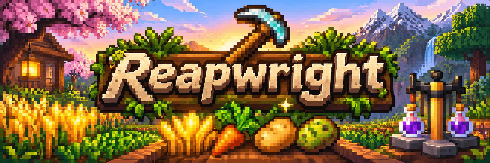
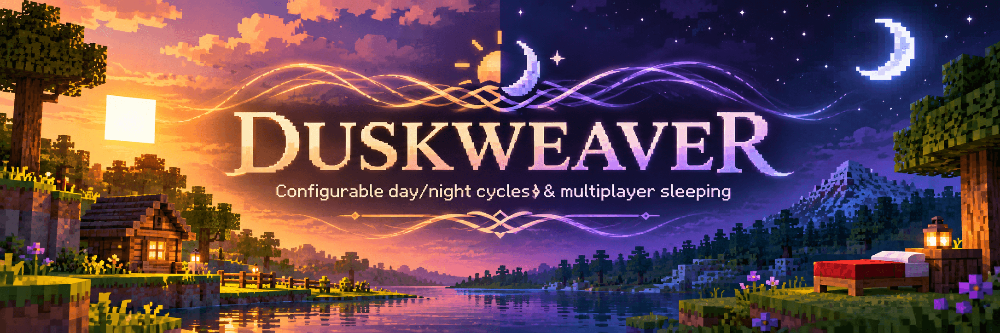
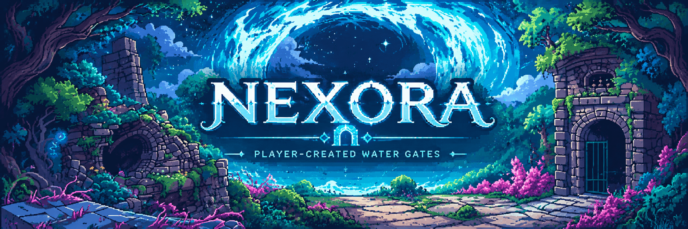

# iruixos

Minecraft server plugins focused on practical quality-of-life improvements, thoughtful gameplay mechanics, and a near-vanilla survival experience.

## Reapwright

**Reapwright** makes crop farming more convenient while keeping survival gameplay intact. Harvest mature crops with a supported hoe, automatically replant using available seeds, and configure the harvesting area to suit your server.

**[View Reapwright on GitHub](https://github.com/iruixos/Reapwright)**

## Duskweaver

**Duskweaver** gives server administrators control over the day/night cycle and sleeping behavior. Set custom day and night durations, configure sleep skipping, and optionally clear bad weather when morning arrives.

**[View Duskweaver on GitHub](https://github.com/iruixos/Duskweaver)**

## VanillaPlusSuite

**VanillaPlusSuite** brings together small, survival-friendly quality-of-life features, including tool durability warnings, pet protection, crop indicators, sign utilities, and other refinements designed to preserve the vanilla feel.

**[View VanillaPlusSuite on GitHub](https://github.com/iruixos/VanillaPlusSuite)**

> **Repository link to verify:** The VanillaPlusSuite URL above assumes the repository is named `VanillaPlusSuite`. Replace it if your repository uses a different name.

## Nexora

**Nexora** adds configurable portal networks to Minecraft. Connect gates using pair, round-robin, or random destination routing, with persistent gate identities and ownership checks to help protect shared networks.

**[View Nexora on GitHub](https://github.com/iruixos/Nexora)**

---

*Built for Minecraft server communities that appreciate useful features without losing the survival experience.*
